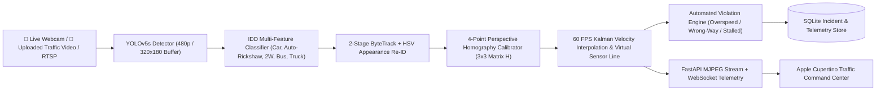

# Real-Time Traffic Monitoring & Incident Detection System (YOLOv5)

An end-to-end computer vision and real-time traffic intelligence platform engineered with **YOLOv5**, **Two-Stage ByteTrack Multi-Object Tracking (with Appearance Re-ID)**, **4-Point Perspective Homography Speed Estimation**, **IDD 3-Wheeler (`Auto-Rickshaw`) Classification**, and a **FastAPI + WebSocket Apple Cupertino Dashboard**.

---

## System Architecture



---

## Key Features

1. **Real-Time YOLOv5 Detection & Indian Traffic Classification (`backend/detector.py`, `scripts/train_yolov5_idd.py`)**
   - Detects and classifies **Cars**, **Auto-Rickshaws (3-Wheelers)**, **Motorcycles**, **Buses**, **Heavy Trucks**, **Bicycles**, and **Pedestrians**.
   - Includes a multi-feature **IDD (Indian Driving Dataset) Classifier** + **Temporal Class Voting** that combines perspective-normalized bounding box area, aspect ratio, and HSV canopy color analysis so 3-wheelers (`Auto-Rickshaw`) are accurately separated from heavy `Truck` detections.
   - Includes [`scripts/train_yolov5_idd.py`](scripts/train_yolov5_idd.py) to fine-tune `yolov5s` natively on IDD classes and export FP16 ONNX weights.

2. **Two-Stage ByteTrack Association + Appearance Re-ID (`backend/tracker.py`)**
   - **Stage 1** matches high-confidence detections ($\text{conf} \ge 0.42$) using a weighted fusion of **IoU ($55\%$)**, **Kalman Centroid Gate ($25\%$)**, and **16-Bin HSV Appearance Histogram Cosine Similarity ($20\%$)**.
   - **Stage 2** recovers partially occluded vehicles ($0.18 \le \text{conf} < 0.42$), preventing Track ID switching when smaller vehicles pass behind buses or trucks.

3. **4-Point Perspective Homography Speed Radar (`backend/tracker.py`)**
   - Solves the $3\times 3$ homography matrix $H$ via Singular Value Decomposition (SVD) to map perspective road pixel coordinates $(x, y)$ into a bird's-eye metric plane ($14\text{ m}$ width $\times$ $28\text{ m}$ depth) for accurate velocity ($\text{km/h}$) calculation.

4. **Zero-Lag 60 FPS Live Camera & Video Upload Pipeline (`frontend/app.js`, `backend/main.py`)**
   - Decouples neural inference onto a lightweight `320×180` offscreen buffer while advancing bounding boxes at a locked **60 FPS** using **Kalman Constant-Velocity Interpolation**.
   - Supports **Live Hardware Webcam (`🎥 Live Camera`)**, **Real Traffic Footage Upload (`📁 Upload Traffic Video` — `.mp4`, `.webm`, `.mov`)**, and **Synthetic Highway Benchmarks**.

5. **Automated Traffic Violation Detection & CSV Reporting (`backend/database.py`, `backend/main.py`)**
   - Automatically flags **Overspeeding**, **Wrong-Way Counter-Flow Driving**, and **Stalled Lane Obstructions** in real time, storing incidents in **SQLite** with one-click **CSV Enforcement Report** export.

---

## Project Structure

```text
real-time-traffic-monitoring-system-yolov5/
├── backend/
│   ├── __init__.py
│   ├── config.py          # Camera presets, calibration constants & class color palettes
│   ├── database.py        # Thread-safe SQLite store for incidents & telemetry snapshots
│   ├── detector.py        # YOLOv5 engine, IDD 3-wheeler classifier & OpenCV HUD renderer
│   ├── main.py            # FastAPI server (MJPEG stream, WebSockets, video upload, CSV export)
│   └── tracker.py         # 2-Stage ByteTrack + Appearance Re-ID + 4-Pt Homography calibrator
├── frontend/
│   ├── index.html         # Apple Cupertino Traffic Intelligence Dashboard
│   ├── styles.css         # Frosted glass header, Bento KPI cards & responsive layout
│   └── app.js             # 60 FPS Kalman interpolation, decoupled neural loop & WebSocket client
├── scripts/
│   └── train_yolov5_idd.py # YOLOv5 fine-tuning & FP16 ONNX export script for Indian Driving Dataset
├── tests/
│   └── test_tracker.py    # Unit tests for IoU, Homography SVD matrix, Re-ID & ByteTrack
├── requirements.txt       # Python dependencies
└── README.md              # Project documentation
```

---

## Quickstart

### 1. Clone & Install Dependencies
```bash
git clone https://github.com/Pavan-Kumar-sys/real-time-traffic-monitoring-system-yolov5.git
cd real-time-traffic-monitoring-system-yolov5
pip install -r requirements.txt
```

### 2. Run the FastAPI + YOLOv5 Server
```bash
uvicorn backend.main:app --reload --host 0.0.0.0 --port 8000
```
Open **`http://localhost:8000`** in your browser.

### 3. Instant Standalone Browser Mode
You can also open `frontend/index.html` directly in Chrome, Edge, or Brave to use **`🎥 Live Camera`** or **`📁 Upload Traffic Video`** immediately using the in-browser WebGL neural + 60 FPS Kalman tracking engine.

### 4. Run Unit Tests
```bash
pytest -v
```
